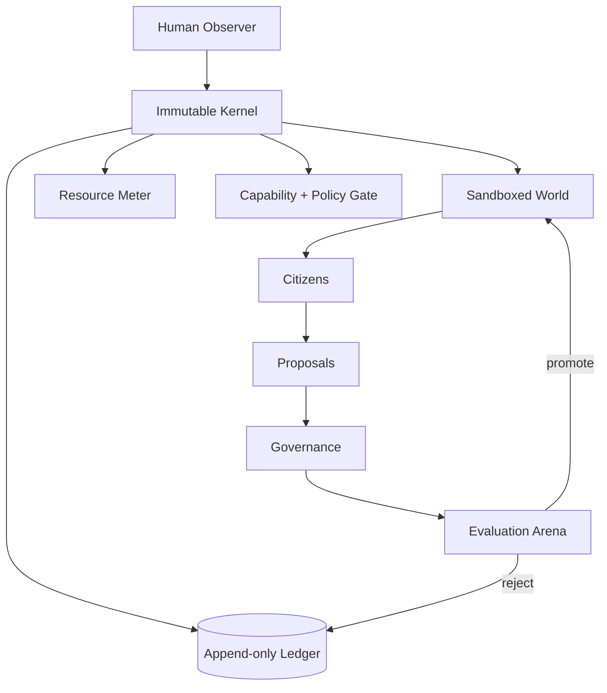

# Architecture

## Trust model

Sovereign Colony has two domains:

1. **Kernel domain** — trusted, minimal, externally governed, immutable to citizens.
2. **World domain** — untrusted, evolvable, replayable, and disposable.

## Kernel responsibilities

- Validate typed actions and capabilities.
- Enforce resource ceilings.
- Append canonical events.
- Derive state from events.
- Isolate files, processes, and network.
- Run deterministic mutation tests.
- Expose pause, replay, fork, rollback, and reset.

The kernel must not contain colony strategy, cultural content, or preferred political outcomes.

## World responsibilities

- Citizen identity and lineage.
- Internal institutions and law.
- Proposals, deliberation, voting, and appeals.
- Rituals and schedules.
- Cultural memory and precedents.
- Work artifacts and approved local dependencies.

## Determinism contract

Given the same genesis seed, kernel version, ordered event stream, and deterministic citizen policy, replay must produce the same world-state digest. LLM-driven behavior enters only after deterministic world mechanics pass this contract; LLM outputs are then persisted as explicit events.

## State model

Canonical state is derived, not edited directly:

- `world`
- `citizens`
- `institutions`
- `laws`
- `rituals`
- `resources`
- `pheromones`
- `proposals`
- `lineages`
- `artifacts`

SQLite is the proposed v0 ledger. Git versions constitutions, genomes, rituals, and promoted artifacts. Neither system replaces the other: SQLite proves what happened; Git proves what changed.

## Sandbox posture

- No host mounts beyond an experiment-owned workspace.
- Read-only base image.
- Ephemeral writable layer.
- No network by default.
- No Docker/Podman socket.
- No credentials in environment.
- Non-root process.
- Process, memory, CPU, disk, and time limits.
- Destroyable world instance.

## Promotion pipeline

`proposal → constitutional validation → deterministic tests → adversarial tests → resource audit → governance ratification → Git commit → activation → observation → rollback if thresholds fail`
